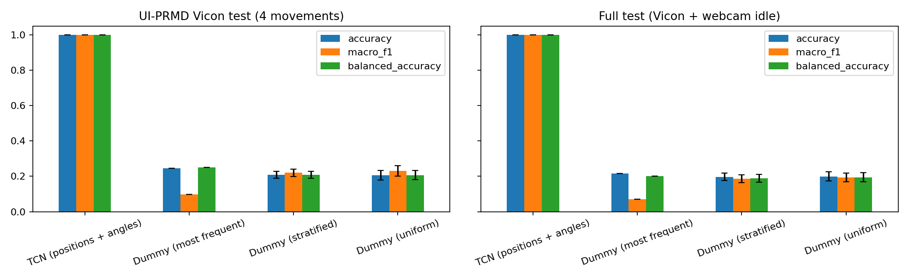
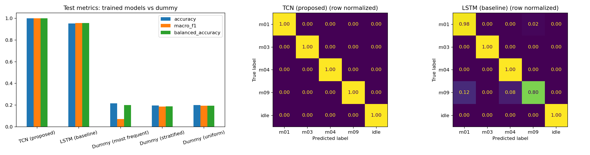
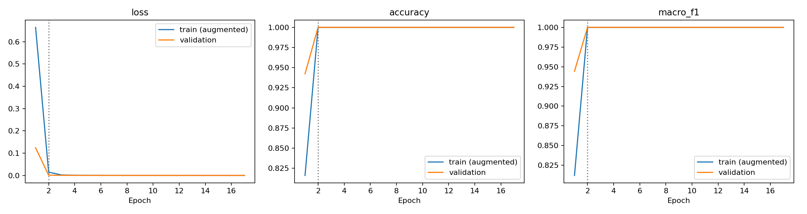
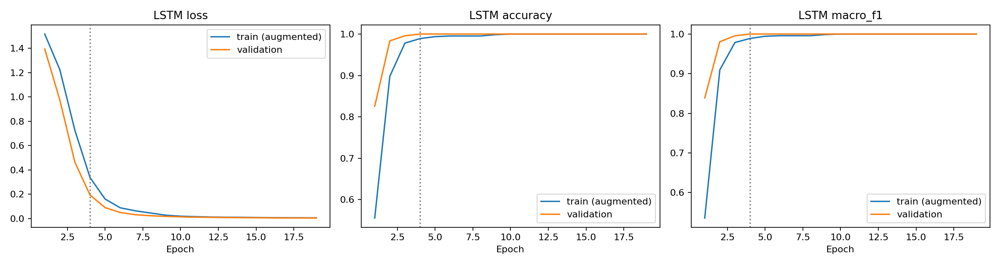
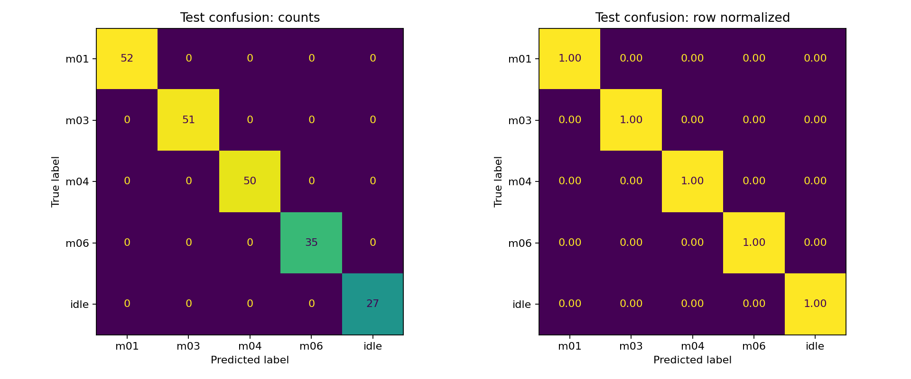
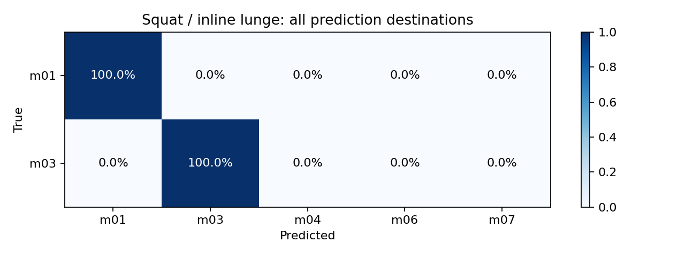
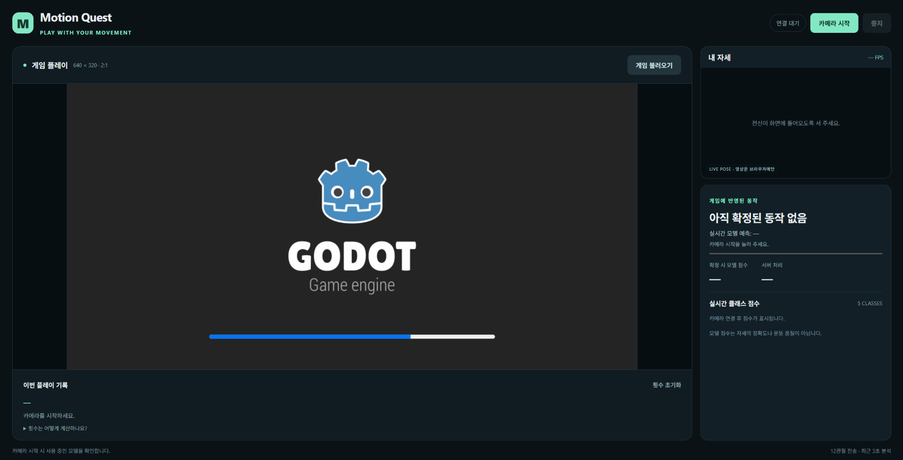
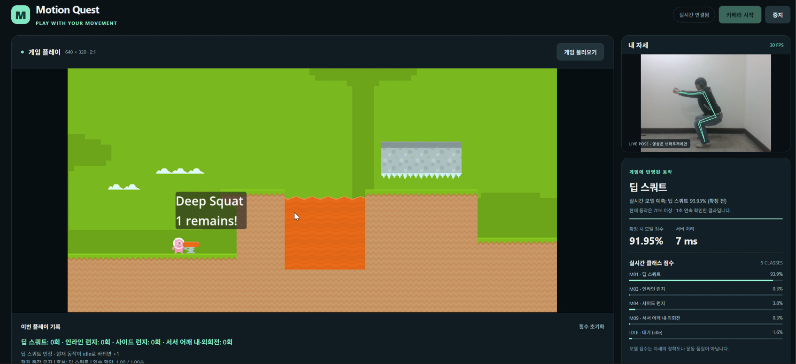
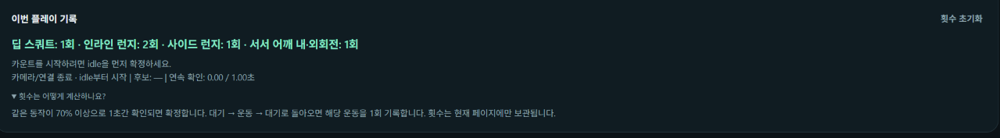

# Motion Quest — AI 동작 인식 기반 홈 트레이닝 게임

웹캠으로 사용자의 움직임을 인식하고 Godot 게임에 연결하여, 집에서 하는 운동을 재미있는 플레이 경험으로 만드는 헬스 케어 기능성 게임입니다. 브라우저의 MediaPipe Pose Landmarker Lite가 관절을 추정하고, 직접 학습한 TCN이 관절 위치와 각도의 시간적 변화를 이용해 동작을 분류합니다.

## 0. 프로젝트 정보

| 항목 | 내용 |
|---|---|
| 프로젝트명 | Motion Quest |
| 학번 | 202435119 |
| 이름 | 한여원 |
| 데모 URL | https://motion-quest.duckdns.org |
| GitHub URL | https://github.com/Sperodd/motion-quest |
| 주요 기술 | Python, PyTorch, TCN, MediaPipe Lite, FastAPI, WebSocket, JavaScript, Godot |

## 1. 문제 정의

### 4W

| 항목 | 정의 |
|---|---|
| Who — 대상 | 집에서 운동하고 싶지만 반복적인 홈 트레이닝에 쉽게 흥미를 잃는 사용자 |
| What — 문제 | 영상 시청이나 횟수 기록만으로는 운동 과정의 재미와 즉각적인 반응을 얻기 어려움 |
| When — 상황 | 집에서 PC와 웹캠을 사용하여 혼자 운동할 때 |
| Why — 필요성 | 자신의 움직임이 게임에 반영되는 경험으로 운동 참여 동기를 높이고자 함 |

### 차별화 방향

**사용자의 몸 움직임을 게임 입력으로 사용**하여 사용자가 적극적으로 운동을 할 수 있도록 돕습니다. 게임을 주 화면에 배치하고 웹캠 포즈와 모델의 클래스별 점수를 옆에 표시하여, 플레이와 동작 인식 상태를 한눈에 확인하도록 구성했습니다. 별도 착용 장비 없이 웹캠을 이용하며, 서버에는 영상 대신 관절 좌표를 전송합니다.

이는 서비스의 설계 방향이며, 기존 제품 대비 우수성이나 운동 지속 효과를 비교 실험으로 입증한 결과는 아닙니다.

### 정량 목표

- 동작 분류 목표: 테스트셋 **Macro-F1 ≥ 0.80**.
- 실제 사용 환경의 검증 기준: 학습에 참여하지 않은 사용자의 웹캠 데이터에서 5개 클래스를 모두 포함하여 동일 목표를 평가.
- 현재 저장된 테스트셋 지표와 실제 웹캠 환경의 검증 범위는 5절에 구분하여 기록합니다.

## 2. 데이터

### 출처와 선정 이유

주 데이터는 University of Idaho의 **UI-PRMD (Physical Rehabilitation Movements Data Set)** 입니다. 운동 동작의 3차원 위치를 제공하므로 영상 모델 전체를 학습하지 않고도 관절 시계열 기반 동작 분류를 실험할 수 있습니다. 스쿼트·런지 등 게임 입력으로 사용할 운동이 포함되어 있다는 점도 선정 이유입니다.

공식 설명상 건강한 참가자 10명이 10개 운동을 각각 10회 반복했으며, Vicon과 Kinect로 수집되었습니다. 데이터 라이선스는 **Open Data Commons Public Domain Dedication and License (PDDL) v1.0**입니다. [공식 데이터 제공 페이지](https://www.idahofallshighered.org/vakanski/ui-prmd.html), [원 논문: Vakanski et al., 2018](https://doi.org/10.3390/data3010002).

대기 상태는 직접 수집한 MediaPipe 관절 좌표를 사용합니다. 이 자체 수집 데이터의 공개·재배포 라이선스는 아직 지정하지 않았으며 UI-PRMD의 라이선스가 자동으로 적용되는 것은 아닙니다.

### 원본 파일 구조

```text
data/
├─ Movements.zip
├─ Movements/
│  ├─ Vicon/
│  │  ├─ Positions/  # m01_s01_positions.txt 등
│  │  └─ Angles/
│  └─ Kinect/
│     ├─ Positions/
│     └─ Angles/
└─ webcam_recordings.json
```

파일명의 `m01`은 운동 번호, `s01`은 참가자 번호입니다. 하나의 Movements 파일은 여러 반복 동작을 포함하는 연속 녹화이며, 한 파일을 한 번의 운동 반복으로 세지 않습니다. 공식 데이터에는 별도의 분절 데이터와 잘못 수행한 동작 데이터도 있으나 현재 학습은 위 Movements의 선택 클래스와 자체 대기 녹화를 사용합니다.

| 원본 | 구조 | 현재 사용 |
|---|---|---|
| Vicon Positions | 행=시간 프레임, 열=39개 마커 × XYZ, 총 117열; 100 Hz | 공통 관절 위치 추출에 사용 |
| Kinect Positions | 22개 관절 × XYZ, 총 66열; 30 Hz | 사용하지 않음 |
| Angles | 센서에서 제공한 각도 | 사용하지 않음; 선택한 XYZ에서 직접 계산 |
| 웹캠 JSON | 녹화 ID·참가자·라벨·분할과 프레임별 시간, 12관절 world XYZ, visibility | 대기 상태 학습에 사용 |

Vicon 데이터는 광학식 모션 캡쳐 방식으로 측정된 상대적으로 정밀한 데이터셋이고, Kinect는 카메라를 기반으로 측정된 데이터셋입니다. 로컬 Vicon 텍스트는 공백 구분 수치이며 로더는 쉼표 구분도 처리합니다. Kinect 위치는 루트를 제외하면 부모 좌표계에 상대적인 값이므로, 회전 변환 없이 MediaPipe world XYZ와 직접 대응시키지 않습니다. Vicon 마커 역시 해부학적 관절 중심과 정확히 같지는 않습니다.

### 현재 학습 데이터 구성

| 코드 | 클래스 | 출처 | 녹화 수 |
|---|---|---|---:|
| m01 | Deep Squat — 스쿼트 | Vicon | 10 |
| m03 | Inline Lunge — 인라인 런지 | Vicon | 9 |
| m04 | Side Lunge — 사이드 런지 | Vicon | 10 |
| m09 | Standing Shoulder Internal-External Rotation — 서서 어깨 내·외회전 | Vicon | 10 |
| idle | Standing Rest — 서서 대기 | 직접 수집한 MediaPipe | 5 |

### 클래스 분포 — 분할별 90프레임 창 수

| 클래스 | Train | Validation | Test | 합계 | 비율 |
|---|---:|---:|---:|---:|---:|
| m01 Deep Squat | 149 | 59 | 52 | 260 | 23.4% |
| m03 Inline Lunge | 112 | 61 | 51 | 224 | 20.2% |
| m04 Side Lunge | 158 | 56 | 50 | 264 | 23.8% |
| m09 Shoulder Int.-Ext. Rotation | 136 | 38 | 51 | 225 | 20.3% |
| idle Standing Rest | 82 | 27 | 27 | 136 | 12.3% |
| **합계** | **637** | **241** | **231** | **1,109** | 100% |

운동 4개 클래스는 20~24%로 비슷하고, idle은 12.3%로 적습니다. 이 불균형은 학습 시 클래스 빈도 기반 가중 Cross Entropy(4절)로 보정하고, 평가는 클래스 불균형에 덜 민감한 Macro-F1과 Balanced Accuracy를 함께 사용합니다.

선택된 Vicon 녹화는 총 **39개**입니다. 공식적으로 누락된 `m03_s03`은 가상의 샘플로 보충하지 않습니다. 자체 웹캠 데이터는 **1명, 5개 녹화, 4,499프레임, 약 150초**이며 모두 idle입니다. 정확한 파일별 길이와 해시는 [data_manifest.csv](ui_prmd_tcn_output/data_manifest.csv), [webcam_manifest.csv](ui_prmd_tcn_output/webcam_manifest.csv)에 저장되어 있습니다.

### 실제 사용한 데이터 총량

현재 학습 실행에 사용한 전체 데이터는 **44개 녹화, 원본 111,537프레임, 약 20분 20초**입니다. 이 중 모델의 가중치 업데이트에 직접 사용한 **Train 데이터는 26개 녹화, 약 11분 43초, 637개 시계열 창**입니다. 나머지는 검증과 최종 평가에 사용했습니다.

| 구분 | 녹화 수 | 원본 프레임 수 | 원본 녹화 시간 | 전처리 후 90프레임 창 수 |
|---|---:|---:|---:|---:|
| Train — 가중치 학습 | 26 | 64,049 | 약 11분 43초 | 637 |
| Validation — 모델 선택 | 9 | 24,220 | 약 4분 23초 | 241 |
| Test — 최종 평가 | 9 | 23,268 | 약 4분 14초 | 231 |
| **합계** | **44** | **111,537** | **약 20분 20초** | **1,109** |

출처별로는 Vicon **107,038프레임, 약 17분 50초**와 웹캠 **4,499프레임, 약 2분 30초**입니다. 시간은 Vicon의 원본 프레임 수 ÷ 100 Hz와 웹캠 녹화의 실제 타임스탬프 길이를 합산했습니다. 서로 다른 샘플링 속도의 원본 프레임을 합한 수치이므로, 원본 프레임 수를 곧바로 모델 입력 샘플 수로 해석하지 않습니다.

모델이 받는 샘플 1개는 **90프레임 × 54특징**입니다. 창은 30프레임 간격으로 생성되어 인접 창끼리 60프레임이 겹칩니다. 따라서 전체 1,109개 창의 길이를 단순 합산한 값은 독립적인 녹화 시간이 아니며, 여러 epoch에서 같은 Train 창을 반복 사용해도 원본 데이터 총량은 늘어나지 않습니다. 전체 참가자는 Vicon 10명과 웹캠 1명이며, 웹캠 참가자는 세 분할에 공통으로 포함됩니다.

## 3. 데이터 전처리

### 공통 관절 선택

좌우 어깨·팔꿈치·손목·골반·무릎·발목의 **12개 관절**을 사용합니다. 아래 순서에서 각 부위의 왼쪽, 오른쪽 순으로 배치합니다.

| 부위 | Vicon 마커 번호 (1부터 시작) | MediaPipe 인덱스 (0부터 시작) |
|---|---|---|
| 어깨 | 10 / 17 | 11 / 12 |
| 팔꿈치 | 12 / 19 | 13 / 14 |
| 손목 | 평균(14, 15) / 평균(21, 22) | 15 / 16 |
| 골반 | 평균(24, 26) / 평균(25, 27) | 23 / 24 |
| 무릎 | 29 / 35 | 25 / 26 |
| 발목 | 31 / 37 | 27 / 28 |

손목과 골반은 마커 평균으로 대응 위치를 근사합니다. 학습과 추론에서 관절 순서가 같아야 하며, MediaPipe는 이미지 정규화 좌표가 아닌 **world landmarks**를 사용합니다.

### 처리 순서와 전·후 비교

| 단계 | 처리 전 | 처리 후 및 목적 |
|---|---|---|
| 1. 라벨 및 파일 선택 | 전체 운동·센서 파일 | 선택한 4개 Vicon 운동과 웹캠 idle, 참가자·녹화 정보 확보 |
| 2. 결측 검사·보간 | 0으로 채워진 마커 또는 비유한 XYZ | 선택 마커별 결측률 5% 이하, 연속 결측 30프레임 이하인 경우 보간; 초과 시 오류로 중단 |
| 3. 공통 관절 변환 | Vicon 프레임당 117개 수치 | 12관절 × XYZ = 36개 위치 수치 |
| 4. 시간 재표본화 | Vicon 100 Hz / 웹캠의 실제 타임스탬프 | Vicon은 anti-alias 필터를 포함한 `resample_poly(3, 10)`, 웹캠은 XYZ 시간 보간으로 30 Hz 구성 |
| 5. 시계열 창 생성 | 길이가 다른 녹화 | 90프레임(약 3초), 간격 30프레임(약 1초)의 창; 녹화 경계를 넘지 않음 |
| 6. 위치 정규화 | 센서 좌표·체격·촬영 위치에 종속된 XYZ | 골반 중심 이동, 창 전체 몸통 길이 중앙값으로 크기 정규화, 몸 기준 좌표계 변환 |
| 7. 각도 생성 | 12관절 XYZ | 같은 XYZ에서 각도 18개 계산 후 위치 36개와 결합 → `[90, 54]` |
| 8. 특징 표준화 | 채널마다 다른 분포 | train 평균·표준편차만 사용, 표준편차 하한 `1e-3`; 모델 내부에서 수행 |
| 9. 학습 증강 | 원래 좌우 방향 | train에서 50% 확률로 좌우 관절·각도 교환 및 위치 lateral 부호 반전 |

위치의 몸 좌표계는 창 평균 좌우 골반 방향을 수평면에 투영한 lateral축, 수직 up축, 두 축의 외적으로 얻는 depth축으로 구성합니다. Vicon의 up은 `[0, 0, 1]`, MediaPipe의 up은 `[0, -1, 0]`입니다. 프레임마다 골반 중심을 빼되, 몸 좌표계와 스케일은 창 단위로 정하여 상대적인 발 배치와 움직임을 보존합니다.

웹캠 학습 데이터는 visibility가 0.5 미만이거나 관측 간격이 200ms를 넘는 부분을 포함한 창을 제외합니다. 중복 세션과 동일 녹화 콘텐츠도 검사합니다. 이 학습용 품질 필터와 현재 실시간 서버의 정책은 다르며, 그 영향은 5절의 한계에 기록했습니다.

### 각도 계산과 입력 형식

세 점 A, B, C에서 B의 내각은 다음과 같이 계산합니다.

```text
u = A - B, v = C - B
angle = arccos(clip(dot(u, v) / (norm(u) × norm(v)), -1, 1)) / π
```

각도 범위는 `[0, 1]`이며, 곧게 편 무릎의 내각 180°는 1입니다. 길이가 0인 벡터는 유효한 각도로 처리하지 않습니다.

- 좌우 무릎·골반·팔꿈치·어깨 내각: 8개
- 양 허벅지 사이·양 종아리 사이 각도: 2개
- 몸통과 수직축 사이 각도: 1개
- 좌우 허벅지·종아리와 아래쪽 수직축 사이 각도: 4개
- 좌우 무릎·골반·허벅지 기울기의 절대 차이: 3개

위치는 발의 상대적 배치와 손목 방향을, 각도는 관절 굽힘과 좌우 비대칭을 표현합니다. 두 정보를 함께 사용하여 스쿼트와 인라인 런지의 구분에 필요한 단서를 제공하려는 설계입니다. 특징 결합 자체가 성능 향상을 입증하는 것은 아닙니다.

[pose_features.py](pose_features.py)의 `window_features()`가 공통 정의입니다. 노트북에는 동일 코드를 삽입하고 학습 결과에는 `preprocess.py`로 저장합니다. 서버는 저장된 전처리 코드와 메타데이터의 해시·입력 계약을 검사합니다. **XYZ를 먼저 시간 보간한 뒤 위치와 각도를 계산**하며, 계산된 각도를 따로 보간하지 않습니다.

### Train / Validation / Test 분할

| 구분 | Vicon 참가자 | Vicon 녹화 / 창 | 웹캠 idle 녹화 / 창 | 전체 창 |
|---|---|---:|---:|---:|
| Train | s01~s06 | 23 / 555 | 3 / 82 | 637 |
| Validation | s07~s08 | 8 / 214 | 1 / 27 | 241 |
| Test | s09~s10 | 8 / 204 | 1 / 27 | 231 |

| 분할 기준 | 값 |
|---|---|
| 분할 단위 | Vicon 참가자 단위 (같은 사람이 두 분할에 들어가지 않음) |
| 참가자 비율 | Train : Validation : Test = **6 : 2 : 2** (60% : 20% : 20%, 10명 중 6·2·2명) |
| 창 수 비율 | 637 : 241 : 231 = **57.4% : 21.7% : 20.8%** |
| 웹캠 idle | 녹화 5개를 3 : 1 : 1로 배정 |
| 고정 분할 | 무작위 추출 없이 참가자 번호로 고정 (`metadata.json`의 `splits`) |
| Random seed | **42** — Python·NumPy·PyTorch(CUDA 포함) 전역 seed. LSTM 학습 직전에도 같은 seed로 다시 설정하여 두 모델의 시작 조건을 맞춤. Dummy 기준선은 seed 42~51 |

먼저 참가자·녹화 단위로 분할하고 각 분할 안에서 창을 생성합니다. 겹치는 창을 만든 뒤 무작위로 분할하지 않습니다. Vicon은 참가자 분리 평가이지만, 현재 웹캠은 동일 참가자 `mp_person01`의 별도 녹화를 나눈 평가입니다. 웹캠의 새로운 사용자에 대한 일반화 평가는 아닙니다.

## 4. 모델

### TCN 구조와 선택 이유

TCN(Temporal Convolutional Network)은 관절 시계열에 1차원 합성곱을 적용합니다. 단일 프레임만으로 모호한 자세를 최근 움직임의 흐름과 함께 분류하기 위해 선택했습니다. Dilation으로 시간 범위를 넓히고 residual 연결로 학습을 돕습니다. 고정 길이 입력을 사용하므로 브라우저에서 모은 최근 구간을 서버에서 처리하기에도 적합합니다.

```text
입력 [B, 90, 54]
 → train 통계로 채널별 표준화
 → [B, 54, 90]으로 축 변환
 → TCN residual block × 4 (64채널, dilation 1 → 2 → 4 → 8)
 → 시간축 평균 pooling
 → Linear(64 → 5)
 → 5개 클래스 logits
 → 서비스에서 softmax 점수 계산
```

각 block은 왼쪽 padding을 사용하는 causal Conv1d 2개와 LayerNorm·ReLU·Dropout으로 구성됩니다. 입력·출력 채널 수가 다르면 residual 경로에 1×1 합성곱을 적용합니다. 합성곱부의 수용 영역은 **61프레임**이며 최종 분류는 90프레임의 시간축 출력을 평균하여 수행합니다.

TCN은 무작위 초기화 후 **처음부터 직접 학습**했습니다. 브라우저의 MediaPipe Lite는 관절 추출을 위한 사전 학습 모델이며, 직접 학습한 동작 분류기와 역할이 다릅니다.

### 학습 파라미터

| 항목 | 설정 |
|---|---|
| 입력 / 출력 | float32 `[B, 90, 54]` / 5개 클래스 |
| Hidden channels / kernel | 64 / 3 |
| Dilation / dropout | `[1, 2, 4, 8]` / 0.2 |
| Optimizer | AdamW |
| Learning rate / weight decay | 0.001 / 0.0001 |
| Batch size / 최대 epoch | 64 / 100 |
| Loss | train 클래스 빈도 기반 가중 Cross Entropy |
| Gradient clipping | 최대 norm 1.0 |
| 모델 선택 | Validation Macro-F1이 가장 높은 checkpoint |
| Early stopping | Validation Macro-F1이 15 epoch 동안 개선되지 않으면 중단 |
| Random seed | 42 |

실제 설정은 [metadata.json](ui_prmd_tcn_output/metadata.json), 구조는 [model.py](ui_prmd_tcn_output/model.py)에 저장되어 있습니다. seed를 고정해도 실행 장치·라이브러리 차이로 결과가 완전히 동일하지 않을 수 있습니다.

### 비교 모델: LSTM 베이스라인

제안 모델과 비교하기 위해 **LSTM 분류기를 같은 데이터로 처음부터 직접 학습**했습니다(노트북 4-1절). 시계열 분류에서 가장 일반적인 순환 신경망 구조이므로, TCN의 합성곱 방식이 실제로 이점이 있는지 확인하는 기준으로 선택했습니다.

```text
입력 [B, 90, 54]
 → train 통계로 채널별 표준화 (TCN과 동일)
 → LSTM 2층 (hidden 64, 층 사이 dropout 0.2)
 → 마지막 시점의 hidden state
 → Dropout(0.2) → Linear(64 → 5)
 → 5개 클래스 logits
```

| 항목 | TCN (제안) | LSTM (베이스라인) |
|---|---|---|
| 시간 정보 처리 | dilated causal 합성곱, 시간축 평균 pooling | 순환 상태 갱신, 마지막 시점 출력 |
| 파라미터 수 | 101,765 | 64,325 |
| 입력·분할·정규화·증강 | 동일 | 동일 |
| Optimizer·학습률·batch·loss·clipping | 동일 (위 표) | 동일 (위 표) |
| 모델 선택·early stopping | Validation Macro-F1, patience 15 | 동일 |
| Seed | 42 | 42 (학습 직전 재설정) |

구조 이외의 조건을 모두 같게 하여, 성능 차이가 학습 설정이 아니라 모델 구조에서 나오도록 했습니다. 서비스에는 LSTM을 연결하지 않았으며 비교·평가 용도로만 저장합니다. 구조는 [lstm_model.py](ui_prmd_tcn_output/lstm_model.py), 가중치는 `lstm_best_state_dict.pt`입니다.

### 학습 로그

두 모델 모두 epoch마다 train·validation의 loss, accuracy, Macro-F1을 CSV로 저장했습니다.

| 모델 | 실행 epoch | 최고 Validation Macro-F1 | 선택된 epoch | 학습 로그 |
|---|---:|---:|---:|---|
| TCN | 16 | 1.0000 | 1 | [history.csv](ui_prmd_tcn_output/history.csv) |
| LSTM | 19 | 1.0000 | 4 | [lstm_history.csv](ui_prmd_tcn_output/lstm_history.csv) |

두 모델 모두 Validation Macro-F1이 1.0에 도달한 뒤 15 epoch 동안 개선이 없어 early stopping으로 종료했습니다. TCN은 epoch 1에 바로 1.0에 도달했고, LSTM은 0.8387 → 0.9806 → 0.9956을 거쳐 epoch 4에 1.0에 도달하여 수렴이 더 느렸습니다. 학습 곡선은 5절에 있습니다.

## 5. 평가 결과

### 저장된 모델의 지표

현재 결과는 `ui_prmd_tcn_output`의 저장 파일 기준입니다. 학습은 16 epoch까지 기록되었고 Validation Macro-F1 기준으로 **epoch 1**의 checkpoint가 선택되었습니다. 이후 같은 F1을 유지한 경우 최고 모델을 교체하지 않는 설정에 따른 결과입니다.

| 평가 지표 | 위치 + 각도 TCN | 평가 범위 |
|---|---:|---|
| Accuracy | 1.0000 | Test 231개 창 |
| Macro-F1 | 1.0000 | 5개 클래스 F1의 평균 |
| Balanced Accuracy | 1.0000 | 클래스별 Recall의 평균 |
| Recording Accuracy | 1.0000 | 녹화 단위 집계 |
| M01 → M03 혼동률 | 0.0000 | 해당 테스트 클래스 |
| M03 → M01 혼동률 | 0.0000 | 해당 테스트 클래스 |

클래스별 비교:

| 클래스 | Precision | Recall | F1 | Test 창 수 |
|---|---:|---:|---:|---:|
| M01 Deep Squat | 1.0000 | 1.0000 | 1.0000 | 52 |
| M03 Inline Lunge | 1.0000 | 1.0000 | 1.0000 | 51 |
| M04 Side Lunge | 1.0000 | 1.0000 | 1.0000 | 50 |
| M09 Shoulder Internal-External Rotation | 1.0000 | 1.0000 | 1.0000 | 51 |
| IDLE Standing Rest | 1.0000 | 1.0000 | 1.0000 | 27 |

출처별 비교:

| Test 출처 | 포함 클래스 | 창 수 | Accuracy |
|---|---|---:|---:|
| Vicon | 4개 운동 | 204 | 1.0000 |
| MediaPipe 웹캠 | idle만 포함 | 27 | 1.0000 |

근거 파일: [metrics.json](ui_prmd_tcn_output/metrics.json), [classification_report.csv](ui_prmd_tcn_output/classification_report.csv), [source_scores.csv](ui_prmd_tcn_output/source_scores.csv), [history.csv](ui_prmd_tcn_output/history.csv).

### Dummy baseline 비교

입력 특징을 보지 않고 **train 라벨 분포만** 사용하는 `sklearn.dummy.DummyClassifier`를 기준선으로 두고, 같은 test 창에서 TCN과 비교했습니다. 기준선은 train 최빈 클래스(M04)만 예측하는 `most_frequent`, train 클래스 비율대로 무작위 예측하는 `stratified`, 5개 클래스를 균등하게 무작위 예측하는 `uniform`입니다. 무작위 기준선은 seed 42~51, 10회의 평균 ± 표준편차입니다.

UI-PRMD(Vicon) test — 4개 운동:

| 모델 | 창 수 | Accuracy | Macro-F1 | Balanced Accuracy |
|---|---:|---:|---:|---:|
| **TCN (위치 + 각도)** | 204 | **1.0000** | **1.0000** | **1.0000** |
| Dummy — most frequent | 204 | 0.2451 | 0.0984 | 0.2500 |
| Dummy — stratified | 204 | 0.2083 ± 0.0198 | 0.2197 ± 0.0201 | 0.2085 ± 0.0199 |
| Dummy — uniform | 204 | 0.2069 ± 0.0267 | 0.2303 ± 0.0290 | 0.2070 ± 0.0266 |

전체 test — Vicon 운동 + 웹캠 idle, 5개 클래스:

| 모델 | 창 수 | Accuracy | Macro-F1 | Balanced Accuracy |
|---|---:|---:|---:|---:|
| **TCN (위치 + 각도)** | 231 | **1.0000** | **1.0000** | **1.0000** |
| Dummy — most frequent | 231 | 0.2165 | 0.0712 | 0.2000 |
| Dummy — stratified | 231 | 0.1965 ± 0.0208 | 0.1861 ± 0.0221 | 0.1883 ± 0.0225 |
| Dummy — uniform | 231 | 0.1996 ± 0.0253 | 0.1944 ± 0.0252 | 0.1945 ± 0.0259 |

UI-PRMD test에서 TCN의 Macro-F1은 가장 높은 기준선보다 약 **0.77** 높습니다. 따라서 모델은 클래스 비율만으로는 얻을 수 없는 관절 시계열 정보를 사용하고 있습니다. 다만 기준선과의 차이는 저장된 test 분할에 대한 결과이며, 위 한계와 마찬가지로 실제 웹캠 운동 인식 성능을 뜻하지 않습니다. Vicon 범위에서 dummy가 idle을 예측하면 오답으로 계산합니다.

기준선의 train 라벨 분포는 창 수 기준 M01 149 · M03 112 · M04 158 · M09 136 · idle 82입니다. 계산은 노트북 4-2절에서 수행하며 scikit-learn 1.6.1 환경의 결과입니다. `stratified`·`uniform` 수치는 라이브러리 버전에 따라 소폭 달라질 수 있습니다.

근거 파일: [baseline_comparison.csv](ui_prmd_tcn_output/baseline_comparison.csv), [baseline_comparison.md](ui_prmd_tcn_output/baseline_comparison.md), [metrics.json](ui_prmd_tcn_output/metrics.json)의 `baseline_comparison`.



### 직접 학습한 모델 비교: TCN vs LSTM

같은 test 231개 창에서 직접 학습한 두 모델과 Dummy 기준선을 비교했습니다(노트북 4-3절). Dummy는 5개 클래스 전체 test 기준의 seed 평균입니다.

| 모델 | 학습 | Accuracy | Macro-F1 | Balanced Acc. | Recording Acc. | M01↔M03 혼동 | 파라미터 |
|---|---|---:|---:|---:|---:|---:|---:|
| **TCN (제안) ✔** | 직접 학습 | **1.0000** | **1.0000** | **1.0000** | 1.0000 | 0 / 0 | 101,765 |
| LSTM (베이스라인) | 직접 학습 | 0.9524 | 0.9558 | 0.9569 | 1.0000 | 0 / 0 | 64,325 |
| Dummy — most frequent | 라벨 분포만 | 0.2165 | 0.0712 | 0.2000 | — | — | — |
| Dummy — stratified | 라벨 분포만 | 0.1965 | 0.1861 | 0.1883 | — | — | — |
| Dummy — uniform | 라벨 분포만 | 0.1996 | 0.1944 | 0.1945 | — | — | — |

LSTM의 클래스별 결과:

| 클래스 | Precision | Recall | F1 |
|---|---:|---:|---:|
| M01 Deep Squat | 0.8947 | 0.9808 | 0.9358 |
| M03 Inline Lunge | 1.0000 | 1.0000 | 1.0000 |
| M04 Side Lunge | 0.9259 | 1.0000 | 0.9615 |
| M09 Shoulder Int.-Ext. Rotation | 0.9762 | **0.8039** | **0.8818** |
| IDLE Standing Rest | 1.0000 | 1.0000 | 1.0000 |

#### 최종 모델 선택: TCN

선택 규칙은 노트북에 코드로 고정했습니다. **test Macro-F1 → 같으면 Balanced Accuracy → 그래도 같으면 이미 서비스에 연결된 TCN** 순서입니다. TCN이 세 지표 모두에서 LSTM보다 높으므로(Macro-F1 +0.0442, Balanced Accuracy +0.0431) **TCN을 최종 모델로 선택**하여 서비스에 사용합니다.

- **정확도:** TCN은 231개 창을 모두 맞혔고 LSTM은 11개를 틀렸습니다.
- **수렴 속도:** TCN은 epoch 1, LSTM은 epoch 4에 Validation Macro-F1 1.0에 도달했습니다.
- **비용:** LSTM이 파라미터는 약 37% 적지만, 서비스는 약 4회/초로 추론하고 TCN도 CPU에서 충분히 빠르므로(6절 캡처의 서버 처리 11 ms) 크기 차이보다 정확도를 우선했습니다.

#### LSTM 오류 사례 분석

LSTM의 오답 11개는 모두 **Vicon 참가자 s10**에서 나왔습니다. 같은 창에서 TCN은 모두 정답이었으며 확신도는 0.93~0.97이었습니다.

| 실제 동작 | LSTM 예측 | 창 수 | LSTM 확신도 |
|---|---|---:|---:|
| M09 어깨 내·외회전 | M01 딥 스쿼트 | 6 | 0.35~0.57 |
| M09 어깨 내·외회전 | M04 사이드 런지 | 4 | 0.37~0.39 |
| M01 딥 스쿼트 | M09 어깨 내·외회전 | 1 | 0.49 |

- **M09에 오류가 집중:** M09는 하체가 거의 움직이지 않고 팔만 회전합니다. 그래서 스쿼트·사이드 런지에서 서 있는 구간과 하체 자세가 비슷하고, 구분 단서는 손목·팔꿈치의 작은 변화뿐입니다. LSTM은 **마지막 시점의 hidden state 하나**로 분류하므로 3초 창 전체의 작은 반복 변화를 놓치기 쉽고, TCN은 **시간축 전체를 평균**하므로 창 전체의 패턴을 고르게 반영한다고 해석합니다. 이 해석은 구조 차이에서 나온 가설이며 별도 실험으로 검증하지는 않았습니다.
- **낮은 확신도:** 오답의 확신도가 모두 0.6 미만이었습니다. 확정 기준(70% 이상 · 1초 유지)을 적용하면 서비스에서는 대부분 확정되지 않았을 오류입니다.
- **녹화 단위는 정답:** 창 단위 오답이 있어도 녹화별 다수결(Recording Accuracy)은 두 모델 모두 1.0입니다.
- **한계:** test 참가자는 2명이고 학습은 seed 42로 1회만 수행했습니다. 같은 노트북을 로컬 CPU에서 실행했을 때 LSTM의 Macro-F1은 0.9922로, 실행 환경에 따라 LSTM 결과가 변동했습니다. 따라서 차이의 크기는 확정적이지 않으며, **"이 test 분할에서 TCN이 더 안정적이었다"** 까지가 확인된 범위입니다. 또한 두 모델 모두 Validation이 1.0으로 포화되어 test 결과를 선택에 사용했으므로, 이 test 수치는 최종 모델의 성능을 다소 낙관적으로 보여줄 수 있습니다.

근거 파일: [model_comparison.csv](ui_prmd_tcn_output/model_comparison.csv), [model_comparison.md](ui_prmd_tcn_output/model_comparison.md), [lstm_classification_report.csv](ui_prmd_tcn_output/lstm_classification_report.csv), [misclassified_examples.csv](ui_prmd_tcn_output/misclassified_examples.csv), [metrics.json](ui_prmd_tcn_output/metrics.json)의 `lstm_baseline`·`final_model`.



### 현재 서비스 모델의 선택 근거

위치와 각도를 결합한 TCN은 관절 굽힘뿐 아니라 발·손목의 상대 위치도 입력으로 활용하며, 학습과 서버에서 같은 특징을 계산할 수 있습니다. 위 비교에서 Dummy 기준선과 LSTM보다 높은 지표를 보였기 때문에 최종 모델로 선택했고, TorchScript로 내보내 서버에서 로드합니다. 다만 특징 조합(각도만 / 위치만) 간의 우열은 별도로 비교하지 않았습니다.

### 분석 그래프



TCN의 학습 손실과 검증 지표의 변화를 확인합니다. 검증 F1이 초기부터 포화된 점은 데이터 규모와 분할 범위를 함께 고려해야 합니다.



LSTM 베이스라인의 학습 곡선입니다. 검증 Macro-F1이 epoch 4에 1.0에 도달하여 TCN보다 수렴이 늦습니다.



저장된 테스트셋에서 클래스 간 오분류를 확인합니다. 현재는 모든 클래스가 정분류되었으나 실제 웹캠 운동 데이터의 결과를 의미하지는 않습니다.



초기 문제였던 M01·M03 구분을 별도로 확인합니다. 이 그래프의 운동 데이터는 Vicon 기반입니다.

### 결과의 한계

- **웹캠 운동 성능 미검증:** 웹캠 test에는 idle만 있습니다. 4개 운동의 실제 MediaPipe 인식 정확도는 현재 수치로 판단할 수 없습니다.
- **센서와 라벨의 상관관계:** 운동은 Vicon, idle은 MediaPipe이므로 모델이 동작보다 센서 특성 차이를 단서로 활용했을 가능성이 있습니다.
- **제한된 독립성:** 웹캠은 같은 사람이 train/val/test에 포함됩니다. 또한 인접 창은 서로 겹치므로 231개 창을 231회의 독립 실험으로 해석할 수 없습니다.
- **좌표 추정의 차이:** Vicon 마커와 MediaPipe 관절 중심은 다릅니다. 웹캠의 가림·깊이 추정 오차·카메라 기울기는 위치와 각도 모두에 영향을 줍니다.
- **학습·실시간 품질 정책 차이:** 학습 웹캠 창에는 visibility·시간 간격 필터가 있지만 현재 서버는 visibility로 필터링하지 않고 긴 시간 공백도 보간합니다. 이때 실제 관측되지 않은 경로가 입력될 수 있습니다.
- **기능 범위:** softmax는 클래스 점수이며 자세의 올바름이나 운동 품질 점수가 아닙니다. idle은 모든 미지 동작이나 사람이 없는 화면을 뜻하지 않습니다. M09의 관절 내각은 어깨 축회전 자체를 직접 측정하지 않습니다.

따라서 저장된 테스트 목표 달성과 실제 서비스에서의 동작 인식 검증은 구분해야 합니다.

## 6. 서비스 프로토타입

### 모델 연동 방식

```text
웹캠
 → 브라우저 MediaPipe Lite: 12개 공통 관절의 world XYZ 추출
 → timestamp·XYZ·visibility를 JSON으로 전송 (WebSocket /ws/pose)
 → FastAPI: 연결별 최근 약 3초 버퍼 유지
 → XYZ를 30 Hz로 보간 → 위치 36 + 각도 18 → [1, 90, 54]
 → TorchScript TCN → 클래스·softmax 점수 반환
 → 브라우저: 현재 동작·점수·운동 구간 카운트 표시
 → 같은 출처의 Godot iframe: 부모 window.PoseTCN을 통해 상태 조회
```

서버는 시작 시 모델을 로드하며 추론 요청 사이에 최소 250ms 간격을 둡니다. 이는 최대 약 4회/초의 추론 주기 설정으로, 측정된 응답 시간은 아닙니다. 영상은 브라우저에 두고 관절 데이터만 서버로 전송합니다.

Godot 게임은 기본 해상도 **640×320, 2:1 비율**로 주 화면에 배치하고, 사이드 영역에 웹캠과 모델 정보를 표시합니다. `/api/config`에서 모델의 클래스·관절 순서·입력 설정을 받아 화면과 연결합니다. 학습용 녹화 코드는 남아 있지만 현재 사용자 화면에서는 녹화 패널을 숨기고 접근을 막았습니다.

같은 클래스 점수가 70% 이상으로 1초 연속 유지되면 현재 동작을 확정합니다. 확정 상태가 `idle → 운동 A → idle`로 바뀌면 해당 운동 구간에 1회를 추가합니다. 이는 구간 카운트이며 실제 신체 동작의 연속 반복 횟수를 보장하지 않습니다.

### 화면 캡처

#### ① 시작 화면 — 게임·웹캠·모델 정보 배치



카메라를 켜기 전의 첫 화면입니다. 가운데 **게임 플레이** 영역(640×320, 2:1)에서 Godot Web 빌드를 불러오고, 오른쪽 **내 자세** 패널에 웹캠과 관절이 표시됩니다. 그 아래에는 **게임에 반영된 동작**과 **실시간 클래스 점수**가 표시됩니다. 오른쪽 위의 **카메라 시작 / 중지** 버튼으로 인식을 제어합니다.

#### ② 운동 인식 중 — 실제 웹캠 스쿼트와 클래스별 점수



실제 웹캠 앞에서 딥 스쿼트를 수행하는 장면입니다. MediaPipe가 추출한 관절이 웹캠 영상 위에 표시되고, 실시간 클래스 점수는 **M01 딥 스쿼트 85.5%**로 가장 높습니다. 게임에 반영된 동작은 아직 직전의 **대기(idle)** 입니다. 70% 이상 · 1초 연속 조건을 채우기 전이라 화면에 "확정 전"으로 표시되기 때문입니다. 서버 처리 시간은 **11 ms**였습니다. 게임 화면에는 스쿼트로 넘어야 하는 장애물 안내 문구가 표시됩니다.

이 장면은 웹캠 운동이 올바른 클래스로 점수화된 정성적 예시 1건입니다. 5절의 한계에서 밝힌 것처럼 웹캠 운동 인식의 정량 평가는 아직 수행하지 않았습니다.

#### ③ 운동 구간 카운트



플레이 후의 **이번 플레이 기록** 패널입니다. 4개 운동이 각각 집계되었습니다(딥 스쿼트 1회 · 인라인 런지 2회 · 사이드 런지 1회 · 어깨 내·외회전 1회). **횟수는 어떻게 계산하나요?** 를 펼치면 확정·카운트 규칙을 사용자에게 안내하며, **횟수 초기화**로 기록을 지울 수 있습니다.

### 사용 방법

1. Chrome 또는 Edge에서 공개 URL https://motion-quest.duckdns.org 에 접속합니다. 로컬에서 실행할 때는 서버를 켠 뒤 `http://localhost:8000`에 접속합니다(실행 방법은 8절).
2. **카메라 시작**을 누르고 카메라 권한을 허용합니다. 머리부터 발목까지 전신이 화면에 들어오도록 섭니다.
3. 약 3초 동안 입력이 쌓이면 분류가 시작됩니다. 먼저 가만히 서서 **대기(idle)** 가 확정되기를 기다립니다.
4. **게임 불러오기**로 Godot 게임을 엽니다. 게임 안내에 맞춰 스쿼트·런지·어깨 회전을 하고, 동작 뒤에는 다시 대기 자세로 돌아옵니다.
5. 끝나면 **중지**를 누릅니다. 기록은 현재 페이지에만 보관되며 **횟수 초기화** 또는 새로고침으로 지워집니다.

### 잘못된 입력 처리

| 상황 | 처리 |
|---|---|
| 형식이 맞지 않는 메시지, 관절 수 ≠ 12, 비유한 좌표, visibility 범위 밖, 역행하는 timestamp | 서버가 `invalid_input`과 원인 메시지를 반환하고, 화면에 "입력 확인: …"으로 표시 ([session.py](server/session.py)) |
| 메시지 크기 초과 / 다른 출처의 WebSocket 연결 | 연결 종료 (코드 1009 / 1008) ([app.py](server/app.py)) |
| 관절을 찾지 못함 | 기존 버퍼를 유지하고 "관절 좌표가 없습니다" 안내 |
| 1.5초 이상 새 예측 없음 | 후보 확인을 초기화하고 마지막 확정 동작만 유지 |
| 카메라 권한 거부 | 권한 허용과 브라우저 변경 안내 |
| 모델 폴더 누락 | 서버 시작 시 재학습·압축 해제 경로를 안내하는 오류로 중단 |

## 7. 배포

| 항목 | 내용 |
|---|---|
| 배포 플랫폼 | OCI (Oracle Cloud Infrastructure)  |
| 공개 URL | https://motion-quest.duckdns.org|

외부에 배포하기 위해 HTTPS 인증서, CPU에서 PyTorch를 실행할 수 있는 서버, `/ws/pose` WebSocket 프록시 설정 등을 진행했습니다.

## 8. 실행 방법

### 실행 환경과 의존성

- 학습: Google Colab GPU 런타임, [ui_prmd_tcn_colab.ipynb](ui_prmd_tcn_colab.ipynb).
- 추론: Python 환경과 CPU에서 FastAPI·PyTorch 실행.
- 클라이언트: 웹캠과 WebGL을 사용할 수 있는 브라우저. 카메라는 localhost 또는 HTTPS 환경에서 실행합니다.
- 서버 의존성: [requirements.txt](requirements.txt) — FastAPI, Uvicorn, NumPy, PyTorch.
- 개발·검증 의존성: [requirements-dev.txt](requirements-dev.txt) — 서버 의존성과 httpx, pandas, SciPy. JavaScript 검증에는 Node.js를 사용합니다.

저장된 학습 메타데이터의 환경은 Python 3.13.16, PyTorch 2.14.1+cu130, NumPy 2.4.6, SciPy 1.16.3, scikit-learn 1.6.1입니다. 이는 학습 산출물에 기록된 버전이며 `requirements.txt`는 서버 패키지의 허용 범위를 지정합니다.

### 로컬 서버 실행

프로젝트 루트에서 PowerShell로 실행합니다.

```powershell
python -m venv .venv
.\.venv\Scripts\python.exe -m pip install -r requirements.txt
.\.venv\Scripts\python.exe -m uvicorn server.app:app --host 127.0.0.1 --port 8000
```

브라우저에서 `http://localhost:8000`을 열고 **카메라 시작**을 누릅니다. 전신 관절이 보이도록 위치한 뒤 약 3초의 입력이 쌓이면 분류가 시작됩니다. **게임 불러오기**로 Godot 화면을 엽니다.

### 가중치와 게임 파일 위치

```text
ui_prmd_tcn_output/
├─ pose_tcn.torchscript.pt  # 서버 추론 모델
├─ best_state_dict.pt      # PyTorch 가중치
├─ model.py                # 모델 구조
├─ preprocess.py           # 학습 당시 공통 특징 계산 코드
├─ metadata.json           # 클래스, 관절, 파라미터, 전처리 해시
├─ normalization.npz       # train 정규화 통계
└─ ...                     # 평가 CSV·JSON·PNG

web/godot/
├─ Motion Quest.html
├─ Motion Quest.js
├─ Motion Quest.wasm
├─ Motion Quest.pck
└─ ...                     # 함께 내보낸 리소스
```

서버 기본 모델 폴더는 `ui_prmd_tcn_output`입니다. 다른 폴더를 사용할 때는 실행 전에 `$env:POSE_MODEL_DIR = '모델_폴더_경로'`를 지정합니다. 재학습 시 가중치·메타데이터·전처리 파일을 **같은 학습 실행의 산출물로 함께 교체**한 뒤 서버를 재시작합니다.

현재 클라이언트가 실제 요청하는 게임 경로는 `/static/godot/Motion%20Quest.html`이며 서버의 `/static`은 `web/`에 연결되어 있습니다. 따라서 게임 Web 내보내기 파일 전체를 **`web/godot/`**에 배치해야 합니다. `.gitignore`의 `godot/` 규칙 때문에 이 폴더는 저장소에 포함되지 않으며, 대신 [web/godot.zip](web/godot.zip)으로 제공됩니다. 클론 후 다음과 같이 압축을 풉니다.

```powershell
Expand-Archive web/godot.zip -DestinationPath web
```
 루트의 `godot/`와 혼동하지 않도록 주의합니다. 현재 서버 구성에서는 스레드 지원을 끈 Web 내보내기를 사용합니다. Godot 연결 코드는 [godot/PoseBridge.gd](godot/PoseBridge.gd)를 참고하며 동일 출처 iframe에서 부모 페이지의 상태를 읽는 방식입니다.

### Colab 재학습

1. Google Drive의 `MyDrive`에 `Movements.zip`과 `webcam_recordings.json`을 준비합니다.
2. 노트북을 Colab에서 열고 GPU 런타임을 선택합니다.
3. 데이터 준비 셀의 `MODE='drive'`, `ZIP_PATH`, `WEBCAM_JSON`을 자신의 파일 위치에 맞춥니다.
4. 위에서부터 셀을 실행하여 데이터 검증·분할·특징 생성·학습·평가·저장을 수행합니다.
5. 생성된 `ui_prmd_tcn_output.zip`을 내려받아 기존 결과를 별도 보관한 후 출력 폴더 전체를 교체합니다.
6. 서버를 재시작하고 `/api/config`에서 `positions_angles_v1`, 입력 특징 54개, 클래스 목록을 확인합니다.

학습 코드의 공통 전처리를 수정했다면 재학습 전에 다음 동기화 스크립트를 실행합니다.

```powershell
.\.venv\Scripts\python.exe scripts/sync_notebook_features.py
```

### 코드 구성과 개발 검증

| 경로 | 역할 |
|---|---|
| `server/app.py` | HTTP·WebSocket 라우팅, 정적 파일 제공 |
| `server/inference.py` | 모델 계약 검사, 특징 변환, 추론 |
| `server/session.py` | 연결별 입력 버퍼와 추론 주기 관리 |
| `server/settings.py` | 서버 경로·통신 제한 설정 |
| `pose_features.py` | 공통 위치·각도 특징 계산 |
| `recording_data.py` | 웹캠 녹화 로딩·품질 검사·창 생성 |
| `web/` | 게임·웹캠·모델 점수 화면, 카운터, Godot 브리지 |
| `scripts/` | 노트북 동기화·데이터 검증 |
| `tests/` | 전처리·서버·브라우저 모듈 검사 |

```powershell
.\.venv\Scripts\python.exe -m pip install -r requirements-dev.txt
.\.venv\Scripts\python.exe -m unittest discover -s tests -v
node --test tests/test_*.mjs
.\.venv\Scripts\python.exe scripts/check_recordings.py data/webcam_recordings.json
```

이 검사는 구현의 동작을 확인하는 절차이며, 실제 웹캠 운동 정확도 평가를 대신하지 않습니다. 원본 `data/`와 가상환경은 Git 추적에서 제외되어 별도 준비가 필요합니다.

## 9. Lessons Learned

### PMI

#### Plus — 잘된 점

- **전체 흐름을 직접 연결:** 웹캠 → MediaPipe → FastAPI·TCN → 브라우저 → Godot까지 학습부터 공개 배포(OCI, HTTPS)까지 한 서비스로 완성했습니다.
- **학습·추론 불일치 방지:** 학습과 서버가 같은 특징 코드(`pose_features.py`)를 쓰고, 서버가 시작할 때 전처리 해시와 입력 계약을 검사하도록 하여 "학습 때와 다른 입력"이 들어가는 문제를 구조적으로 막았습니다.
- **공정한 모델 비교:** TCN과 LSTM을 같은 분할·정규화·optimizer·seed·early stopping으로 학습하여 구조 차이만 비교했고, Dummy 기준선까지 포함한 비교표와 선택 규칙을 노트북 코드로 남겼습니다.
- **개인정보 보호:** 영상은 브라우저에만 두고 관절 좌표만 서버로 보냅니다.

#### Minus — 아쉬운 점

- **센서와 라벨이 겹침:** 운동은 Vicon, idle은 웹캠으로 출처가 나뉘어 있어 test 100%가 실제 웹캠 운동 인식을 보장하지 않습니다.
- **웹캠 데이터 부족:** 직접 수집한 웹캠 데이터는 1명의 idle 5개 녹화뿐이어서, 웹캠 운동 정확도를 정량 평가하지 못했습니다.
- **Validation 포화:** TCN은 epoch 1, LSTM은 epoch 4에 Validation Macro-F1이 1.0이 되어, Validation만으로는 두 모델의 우열을 가릴 수 없었습니다. 결국 test로 모델을 선택해야 했습니다.
- **반복 실험 부족:** 각 모델을 seed 1개로 한 번만 학습하여, LSTM 결과가 실행 환경에 따라 0.96~0.99로 흔들리는 정도를 분산으로 제시하지 못했습니다.

#### Interesting — 흥미로운 점

- **100%가 오히려 경고 신호:** Dummy 기준선(Macro-F1 0.07~0.23)보다 훨씬 높아 모델이 관절 정보를 쓰는 것은 분명했지만, 모든 지표가 1.0이라는 사실이 오히려 데이터 구성의 한계를 드러냈습니다.
- **같은 데이터, 다른 오류:** Validation에서는 똑같이 1.0이던 TCN과 LSTM이 test에서는 달랐습니다. LSTM의 오류는 한 참가자(s10)의 어깨 회전(M09)에 몰려 있었고, 동작의 특성(하체가 거의 움직이지 않음)과 구조의 특성(마지막 시점만 사용)이 함께 드러났습니다.
- **두 골격 체계 맞추기:** 센서가 다른 두 골격을 12개 공통 관절로 맞추면서 좌표계(Vicon up=`+Z`, MediaPipe up=`−Y`)와 관절 정의의 차이를 직접 다뤄야 했습니다.

### 문제 해결 사례

| 문제 | 원인 | 시도 | 결과 |
|---|---|---|---|
| 스쿼트(M01)와 인라인 런지(M03)의 혼동 | 관절 각도만으로는 두 동작의 다리 굽힘이 비슷하고, 발의 앞뒤 배치 정보가 없음 | 몸 기준 좌표로 정규화한 위치 36개를 각도 18개와 결합하여 발 배치를 입력에 포함하고, M01·M03 혼동 분석 그래프를 별도로 저장 | 저장된 test에서 M01→M03, M03→M01 혼동률 모두 0.0000 (TCN·LSTM 공통). 단 Vicon 기준이며 웹캠 운동은 미검증 |
| 운동하지 않는 상태도 운동으로 분류됨 | UI-PRMD에는 대기 상태 클래스가 없음 | 웹캠으로 서서 대기하는 모습을 직접 녹화(5개, 약 150초)하여 5번째 클래스 idle로 추가하고, 쓰지 않는 M07 클래스는 제거 | idle test 27개 창 모두 정분류. `idle → 운동 → idle` 전이로 운동 구간 카운트를 구현 |
| Vicon과 MediaPipe 골격 불일치 | 마커 39개와 landmark 33개의 정의·좌표축이 다름 | 좌우 12개 공통 관절을 정의하고 손목·골반은 마커 평균으로 근사. 축 방향을 메타데이터에 기록하고 몸 기준 좌표계로 변환 | Vicon으로 학습한 모델이 웹캠 입력을 받아 실제 스쿼트를 M01 85.5%로 점수화 (6절 캡처, 정성 예시 1건) |
| 학습·서버 전처리 불일치 위험 | 노트북과 서버가 특징 코드를 각각 가지고 있음 | `pose_features.py`를 단일 원본으로 두고 `sync_notebook_features.py`로 노트북에 삽입. 서버는 시작 시 해시와 입력 계약을 검사 | 전처리가 다르면 서버가 시작 단계에서 오류로 중단. 전처리 일치 여부를 `tests/`의 단위 테스트로 확인 |
| test 100%의 의미를 판단할 기준이 없음 | 비교 대상 없이 단일 모델 지표만 기록됨 | Dummy 기준선 3종(4-2절)과 직접 학습한 LSTM 베이스라인(4-1절)을 같은 조건으로 추가하고, 선택 규칙을 코드로 고정(4-3절) | Dummy Macro-F1 0.07~0.19, LSTM 0.9558, TCN 1.0000. 규칙에 따라 TCN을 최종 모델로 선택하고, LSTM 오류 11건을 사례로 분석 |

### 향후 개선 계획

- **[데이터] 웹캠 운동 데이터 수집:** 4개 운동 모두를 여러 사람·촬영 각도·조명 조건에서 MediaPipe로 녹화하고, 사람 단위로 분할하여 평가합니다.
- **[데이터] 센서 편향 제거:** 운동과 idle이 같은 센서에서 나오도록 데이터를 구성하여, 모델이 센서 차이를 단서로 쓰는지 확인합니다.
- **[모델] 반복 실험과 추가 비교:** 여러 seed로 TCN·LSTM을 반복 학습해 평균 ± 표준편차로 비교하고, 각도만 / 위치만 / 위치 + 각도 특징 조합을 비교합니다. 웹캠 운동 데이터가 생기면 두 모델을 그 데이터로 다시 평가합니다.
- **[서비스] 실시간 품질 정책 통일:** 학습에서 쓰는 visibility·시간 간격 필터를 서버 추론에도 적용합니다.
- **[서비스] 반복 횟수 검출:** 구간 카운트 대신 관절 각도 주기를 이용해 실제 반복 횟수를 셉니다.
- **[서비스] 게임 반응 조정과 플레이 검증:** 동작별 확정 시간과 상호작용 타이밍을 조정하고, 오인식·반응 지연·조작 난이도를 사용자 테스트로 확인합니다.

